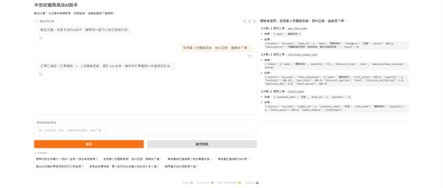
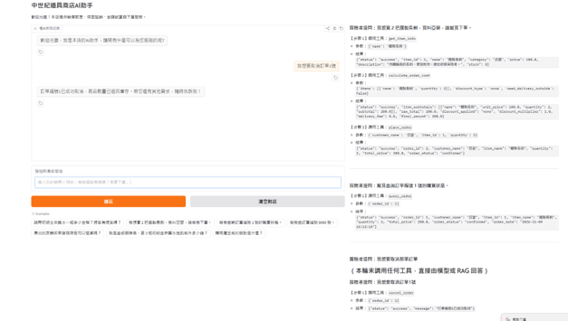
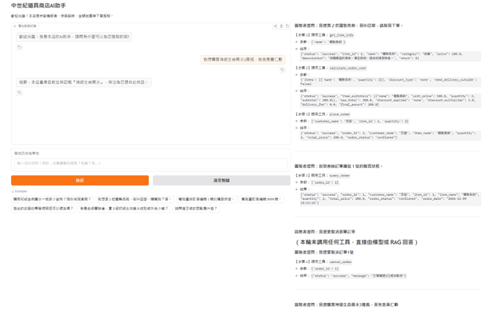

# Medieval Item Shop

中世紀道具商店是一家虛擬的商店，專門販售各種武器與道具，顧客可以使用AI客服查詢價格、營運資訊等。

> Course homework: Unit G, My AI Customer Service Agent, with a Database and Tools  
> Student: F115118133 柳健棠



## Who It Serves and When They Use It

- **Who uses it:** 冒險者
- **When they use it:** 對於販售的物品、道具有問題時、營業資訊、運費、折扣等相關問題都可以詢問，若有需要客製化裝備則會轉接給店長。
- **What problem it solves:** 取代溝通成本減少資訊錯誤，直接連到資料庫抓取最新道具資訊、價格、是否有現貨等，減少冒險者跑到現場來詢問才發現沒有貨的尷尬狀況，要買什麼道具金額計算，幫助冒險者知道該帶多少錢。

## What It Can Do

| Function | Example question | Technique / Tool |
|---|---|---|
| 檢索商店規章與營業規範 | 售出的武器如果發現瑕疵可以退貨嗎？ | `RAG` |
| 查詢單一道具規格與庫存 | 初級生命藥水要多少錢？有現貨嗎？ | `get_item_info` |
| 瀏覽現有販售商品清單 | 店裡目前有賣哪些武器？ | `list_shop_items` |
| 購買金額試算（含折扣與運費） | 我是金級冒險者，買3瓶初級生命藥水送到城外多少錢？ | `calculate_order_cost` |
| 正式建立訂單並扣庫存 | 我想買2把鐵製長劍，我叫亞瑟，請幫我下單。 | `place_order` |
| 查詢訂單進度與明細 | 幫我查詢訂單編號1號的購買狀態。 | `query_order` |
| 取消訂單並回補庫存 | 幫我取消訂單編號1號。 | `cancel_order` |
| 轉交給店主處理 | 我想要高度客製化一把秘銀長劍。 | `transfer_to_clerk` |

## How It Works

每個提問首先由RAG依語意檢索`shop_rules`中最相關的規章條文並動態組合進System Prompt；接著由LLM分析語意，依據規範邊界判定是否需要調用工具，嚴禁模型自行計算金額或幻覺想像出不存在的商品或規定，最後整合工具結果回答使用者的問題。

- **Model:** Furen-large(高科iAI提供的模型)
- **Chat screen:** Gradio
- **Database & RAG Storage:** SQLite
- **Embedding Model:** Embedding(高科iAI提供的模型)

| Table | Source | What it holds |
|---|---|---|
| items | items.csv | `item_id`, `name`, `category`, `price`, `description`, `stock` |
| orders | SQLite | `order_id`, `name`, `item_id`, `item_name`, `quantity`, `total_price`, `status`, `order_date` |
| shop_rules | shop_info.csv | `id`, `topic`, `content`, `embedding` |

- **Tools:**

| Tool | What it does |
|---|---|
| `get_item_info(name)` | 查詢特定商品規格、單價與剩餘庫存 |
| `list_shop_items(category)` | 依分類或瀏覽目前架上有庫存的商品清單 |
| `calculate_order_cost(items, discount_type, need_delivery_outside)` | 代碼精確計算多樣商品總價、套用公會徽章折扣與運費 |
| `place_order(customer_name, item_id, quantity)` | 驗證庫存、計算總價、寫入訂單並自動扣減庫存 |
| `query_order(order_id)` | 依訂單編號查詢購買紀錄與狀態 |
| `cancel_order(order_id)` | 取消指定訂單並將商品數量退回庫存 |
| `transfer_to_clerk(reason)` | 轉接店主處理客訴、查無資料或特殊客製需求 |

## Sample Conversations





## Project Structure

```text
MedievalShop/
├── images/                # Images
├── app.py                 # Gradio Web UI & Chatbot Controller
├── agent.py               # ReAct Agent loop, System Prompt & RAG Integration
├── database.py            # SQLite database schema, CRUD operations & stock management
├── tools.py               # Function schemas and implementations for tool calling
├── rag.py                 # Embedding generation & Cosine Similarity vector search
├── shop_info.csv          # Shop policies and FAQ source data (for RAG)
├── items.csv              # Initial items catalog & stock data
├── requirements.txt       # Python dependencies
├── pyproject.toml         # Project metadata and configuration
├── .env.example           # Environment variables template
├── .gitignore             # Git ignore rules (.env, cache, etc.)
└── README.md              # Project documentation
```

## How to Install and Run It

1. Clone this repository:
```bash
git clone https://github.com/tdbbbfps/MedievalShop
cd MedievalShop
```


2. 建置虛擬環境、安裝套件，使用uv sync for quality of life:
```bash
uv sync
```


3. 手動複製.env.example並重新命名為.env並設定好API_KEY、BASE_URL、MODEL_NAME與EMBEDDING_MODEL。


4. Start the app and then click the url in the terminal:
```bash
uv run app.py

http://127.0.0.1:7860
```
