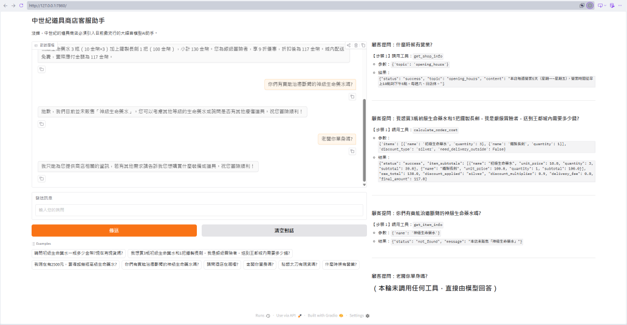
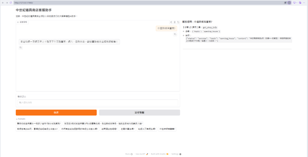
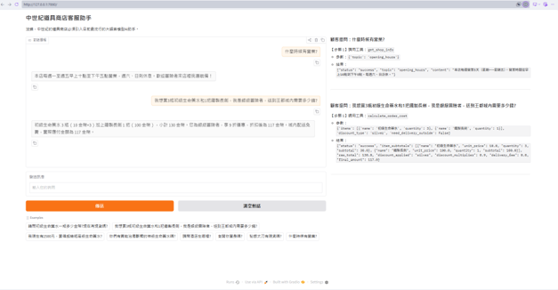

# Medieval Item Shop

中世紀道具商店是一家虛擬的商店，專門販售各種武器與道具，顧客可以使用AI客服查詢價格、營運資訊等。

> Course homework: Unit G, My AI Customer Service Agent, with a Database and Tools  
> Student: F115118133 柳健棠



## Who It Serves and When They Use It

- **Who uses it:** 冒險者
- **When they use it:** 對於販售的物品、道具有問題時、營業資訊、運費、折扣等相關問題都可以詢問，若有需要客製化裝備則會轉接給店長。
- **What problem it solves:** 取代溝通成本減少資訊錯誤，直接連到資料庫抓取最新道具資訊、價格、是否有現貨等，減少冒險者跑到現場來詢問才發現沒有貨的尷尬狀況，要買什麼道具金額計算，幫助冒險者知道該帶多少錢。

## What It Can Do

| Function | Example question | Tool it uses |
|---|---|---|
| 檢索商店資訊 | 你們營業時間是什麼時候? | `get_shop_info` |
| 檢索物品的價格、描述、資訊等 | 初級生命藥水要多少錢? | `get_item_info` |
| 計算價格、折扣與運費 | 我想購買3瓶初級生命藥水跟1瓶初級魔力藥水，總共要多少錢? | `calculate_order_cost` |
| 轉交給店員處理 | 我想要訂製一把武器。 | `transfer_to_clerk` |

## How It Works

每個問題都先丟給agent決定是否需要調用工具、要調用哪個工具，最後根據取得的資訊做回覆。

- **Model:** Furen-large(nemotron-3-super-120b)
- **Chat screen:** Gradio
- **Database (SQLite):** SQLite, csv

| Table | CSV file | What it holds | Rows |
|---|---|---|---|
| `shop_info` | `shop_info.csv` | topic,content | 8 |
| `items` | `items.csv` | item_id,name,category,price,is_available,description | 15 |

- **Tools:**

| Tool | What it does |
|---|---|
| `get_shop_info(topic)` | 讀取目標topic的資訊 |
| `get_item_info(name)` | 取得目標item的價格、是否可購買、描述等資訊 |
| `calculate_order_cost(items, discount_type, need_delivery_outside)` | 獲取物品價格並進行計算、套用折扣、加上運費 |
| `transfer_to_clerk(reason)` | 轉交給店員進行處理 |

## Sample Conversations





## Project Structure

```text
MedievalShop/
├── app.py                # Gradio UI
├── agent.py              # Agent loop and logics
├── database.py           # Database
├── tools.py              # Tools for agent to call
├── test.py               # Benchmark
├── shop_info.csv         # Shop info
├── items.csv             # Items info
├── requirements.txt      # Python dependencies
├── pyproject.toml        # Python dependencies
├── uv.lock
├── python-version
├── .env.example
├── .gitignore
└── README.md             # Project documentation

```

## How to Install and Run It

1. Clone this repository:
```bash
git clone https://github.com/tdbbbfps/MedievalShop

```


2. Use uv for better life:
```bash
uv sync
```


3. 手動複製.env.example並重新命名為.env並設定好API_KEY、BASE_URL與MODEL_NAME。


4. Start the app and then click the url in the terminal:
```bash
python app.py

http://127.0.0.1:7860
```